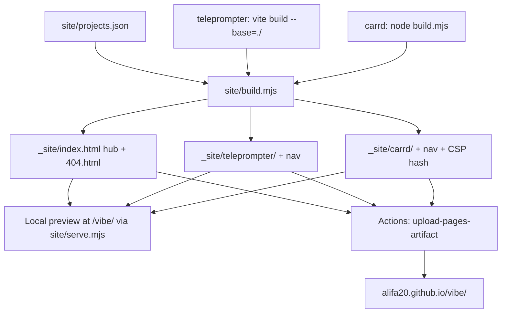

# GitHub Pages Project Hub - Plan

## Goal Capsule

- **Objective:** A visitor to `https://alifa20.github.io/vibe/` can browse all eight vibe-coded projects from one menu. They can open the two static demos and move between projects without the browser back button. A visitor to the GitHub repo sees a clean README that indexes the same projects.
- **Means:** A zero-dependency Node build in `site/` assembles a hub page and the static demos into one artifact, which a GitHub Actions workflow deploys (KTD1, KTD2).
- **Authority:** Product Contract requirements win on behavior. KTDs win on mechanism. Unit text never overrides either.
- **Stop conditions:** Stop and ask if a static demo cannot be made to work under a sub-path without changing its runtime behavior.
- **Execution profile:** All work happens on a feature branch, never `main` (ce-polish refuses the default branch). Units U1–U6 are executor work. U7 is a user-driven `ce-polish` session.
- **Who finishes:** The executor lands U1–U6 locally and verifies them. The user drives U7, then decides on push, PR and merge. Before the merge, Pages must be switched to Source: GitHub Actions (U5). Merging to `main` triggers the first deploy.

---

## Product Contract

### Summary

The plan builds a GitHub Pages hub for the eight projects in this repo, with a shared navigation bar on the live demos. Teleprompter and the personal site (`carrd/`) get working demos, built from source by a GitHub Actions workflow. The six server-backed apps get hub cards that link to their source and setup instructions. It also cleans up the repo: a root README that indexes the projects, the projects' own names in place of copied product names, real content in place of the personal site's placeholders, and no hand-patched build output.

### Problem Frame

The repo holds eight self-contained experiments, each with its own README and stack, under a two-line root README. A draft hub page sits in an untracked `docs/` folder next to copies of the carrd and teleprompter builds. Someone edited those copies by hand to use relative asset paths (`./assets/…`), but the source builds still emit root-absolute paths (`/favicon.svg`, `/assets/…`), so rebuilding would break them under `/vibe/`. GitHub Pages is not enabled on `alifa20/vibe`. Nothing links one demo to another, and the hub cards use the names of the products these projects copy (Bitly, Linktree, Tally, Senja, Zcal, Carrd) rather than the projects' own names.

### Key Decisions

- **Only fully static projects get live demos.** The six server apps (Node + SQLite, Cloudflare Workers, Next.js) get source links and run instructions, not mock demos. Chosen over adding static or mock demo modes. Governs R3.
- **Display names are the projects' own names from the list in U1, with "inspired by X" in small print.** Chosen over keeping the copied product names. Governs R2.
- **A shared navigation bar on demo pages, not a hub-only menu.** Governs R4, R5.

### Requirements

**Hub and navigation**

- R1. The hub at `/vibe/` lists all eight projects, each with a display name, a one-line description, a stack tag, and a source link.
- R2. Each card shows the project's own name. Projects that copy an existing product say "inspired by <product>" in secondary text.
- R3. Cards for teleprompter and personal-site link to the live demo. The other six cards link to the project folder on GitHub, with a note that the app needs a server to run.
- R4. Every demo page shows a slim navigation bar with a link back to the hub and a way to switch to the other live demo.
- R5. The navigation bar does not cover or block any demo control, and it does not appear in the teleprompter's full-screen prompter view.
- R6. The hub and the navigation bar work at phone width and in light and dark color schemes.
- R7. A request for a missing path under `/vibe/` returns a 404 page that links back to the hub.

**Demos work under a sub-path**

- R8. Every asset, favicon and internal link in both demos resolves when the demo is served from `/vibe/<slug>/`.
- R9. The personal-site demo has no form that posts to a missing backend. Visitors reach the owner through links that work on a static host.
- R10. The personal-site demo has no placeholder content: no `example.com`, no `yourhandle`, and no made-up project entries.

**Publishing and repo hygiene**

- R11. A push to `main` builds the site from source and publishes it to GitHub Pages. No built output is committed.
- R12. The root README introduces the repo, lists the eight projects (name, what it is, stack, demo or run link) and links to the Pages site.
- R13. Names and one-line descriptions come from one source of truth, so the hub cards and navigation bar always match.

### Acceptance Examples

- AE1. **Covers R4, R5.** Given a visitor on `/vibe/teleprompter/`, when they start the prompter, then the prompter's full-screen overlay covers the navigation bar. When they leave the prompter, the bar is visible again.
- AE2. **Covers R8.** Given the built site served from a local `/vibe/` prefix, when every demo page is loaded, then the browser reports no 404 for any CSS, JS, image or favicon request.
- AE3. **Covers R4, R8.** Given the personal-site page with its Content-Security-Policy meta tag, when it loads with the injected navigation bar, then the bar is styled and the console shows no CSP violation.

### Success Criteria

- The Pages URL loads on a phone and a desktop, and a first-time visitor can reach each demo and get back to the hub in one tap.
- The first deploy after merge goes green with no manual file copying.

### Scope Boundaries

- Refactoring, restyling or fixing bugs inside any project's own code is out of scope. The only project code changes are the carrd build and content fixes that R8–R10 require.
- No analytics, custom domain or search.
- Per-project READMEs stay as they are.

#### Deferred to Follow-Up Work

- A static snapshot of `linktree`. Its build already produces a static page, but click tracking needs the server.
- Hosted deployments of the server apps (Workers, a VPS, Vercel), linked from their hub cards.
- Generating the root README's project table from `site/projects.json`.

### Open Questions

- Deferred, non-blocking: which email, LinkedIn and X handles the personal site should show. Until the user supplies them, U2 removes those links and keeps GitHub (`alifa20`).

---

## Planning Contract

### Key Technical Decisions

- KTD1. **Deploy with GitHub Actions from a build artifact. No build output is committed under `docs/`.** The workflow builds the demos from source, assembles `_site/`, and publishes it with `actions/configure-pages@v5`, `actions/upload-pages-artifact@v4` and `actions/deploy-pages@v4`. The deploy job needs `pages: write` and `id-token: write` permissions and the `github-pages` environment. The root `.gitignore` already ignores `dist`, so committed build output would fight the repo's own rules. (session-settled: user-approved — chosen over a committed `docs/` folder served from `main` + `/docs`: hand-patched copies drift from source.)
- KTD2. **`site/` holds a zero-dependency Node assembler driven by `site/projects.json`.** The manifest is the single source of truth (R13). At the top level it holds `basePath` (`/vibe/`). Each project entry holds a slug (always the project's folder name, which is also its URL segment), display name, inspired-by, description, stack, and an optional `demo` block (build command, output dir). `site/build.mjs` renders the hub, builds and copies each demo, and injects the navigation bar. This matches the zero-dependency, Node-stdlib style of `carrd/build.mjs` and `linktree/scripts/build.mjs`.
- KTD3. **The assembler injects the navigation bar into built HTML.** It adds one `<nav>` element and one `<style>` block, with no script. When a page has a `Content-Security-Policy` meta tag, it adds the style block's `sha256` to `style-src`. `carrd/build.mjs` allows only hashed inline styles, and the nav would render unstyled without this step. An iframe shell was rejected because it breaks the teleprompter's fullscreen and microphone permissions and loses deep links. Per-project nav hooks were rejected because they touch every project's build.
- KTD4. **The navigation bar is a fixed-height, in-flow strip at the top of `<body>`, not a fixed overlay.** The teleprompter's `.prompter` is `position: fixed; inset: 0` (`teleprompter/src/styles.css`), so the prompter covers the strip on its own (AE1). The strip's height is a custom property (`--vibe-nav-h`). The injected style shortens a following full-height app root by that height (`.vibe-nav + #root { height: calc(100% - var(--vibe-nav-h)) }`). This matters because the teleprompter sets `html, body, #root` to `height: 100%`, and without the rule its library view would overflow by the strip's height and show a page-level scrollbar. On pages with no `#root`, the rule matches nothing. The strip uses only class selectors, because the CSP blocks inline `style` attributes.
- KTD5. **Teleprompter builds with Vite's relative base via the CLI (`--base=./`).** `teleprompter/vite.config.ts` stays untouched, so `npm run dev` still serves from `/`. Vite documents relative base as supported for an unknown deploy path, and relative paths also work under the local preview prefix.
- KTD6. **`carrd/build.mjs` emits relative URLs for the favicon, avatar and 404 backlink.** It currently emits `/favicon.svg`, `"/" + relative(...)` for the avatar, and `href="/"` for the backlink. Every page sits at the root of `dist/`, so `./` is correct everywhere and matches the paths someone hand-patched into `docs/carrd/`. Canonical and OG URLs stay absolute and use `site.url`.
- KTD7. **The contact form renders only when an endpoint is configured.** A static host has no `/api/contact`. `content.json` declares the endpoint. If it is absent, the build leaves out the form and the script that posts it. Leaving out `src/app.js` also removes its hash from `script-src`. The contact section's other content depends on what is configured (R9):
  - If only `email` is set, the section shows its heading and a mailto link, with intro text that does not mention a form. Today the mailto link renders only inside the form's note, so it has to move out of the form.
  - If neither an endpoint nor an email is set, the build leaves out the whole contact section, and the social links (GitHub `alifa20`) are the way to reach the owner.
- KTD8. **The local preview server serves `_site/` under `/vibe/`.** `site/serve.mjs` uses only the standard library and maps `/vibe/*` to `_site/*`. Base-path bugs then show up locally, exactly as on Pages, and `ce-polish` has a live server to attach to.
- KTD9. **The workflow runs on Node 22.** Vite 8 needs Node ≥ 20.19 and the other packages declare ≥ 18–22. The workflow runs the assembler's tests before it deploys.
- KTD10. **The root 404 page uses absolute `/vibe/` links.** GitHub Pages serves the site-root `404.html` for any missing path at any depth, so relative links would break. The manifest's `basePath` provides the prefix.

### High-Level Technical Design



The hub is plain static HTML rendered at build time, so the menu works without JavaScript. The draft `docs/index.html` renders its cards client-side, and its visual design (tokens, card grid, light and dark schemes) is the starting point for the hub template.

### Output Structure

```text
site/
  projects.json      manifest: source of truth for hub and nav
  build.mjs          builds demos, renders hub + 404, injects nav
  nav.mjs            nav markup/style + CSP patch (pure functions)
  hub.mjs            hub + 404 rendering (pure functions)
  serve.mjs          local preview under /vibe/
  build.test.mjs     node:test suite
.github/workflows/pages.yml
package.json         root scripts only, no dependencies
```

### Assumptions

- The repo owner enables Pages once with **Source: GitHub Actions**, either in repo settings or with an approved `gh api` call. A workflow's `GITHUB_TOKEN` cannot turn Pages on by itself.
- GitHub's Ubuntu runners include Chrome, so `carrd/build.mjs` can rasterise `og.png` in CI. If none is found it warns and continues, and the page still works without the OG image.

### Risks

- **CSP hash drift.** If the nav style changes after the hash is computed, the personal site renders an unstyled nav. Mitigation: compute the hash from the exact bytes injected, in the same function, and test it (U3).
- **Teleprompter speech recognition** needs HTTPS and microphone permission. Pages serves HTTPS, so the injected nav does not affect this.
- **The deploy step first runs on `main`.** GitHub accepts `workflow_dispatch` only for workflows already on the default branch, and the `github-pages` environment accepts deploys only from `main`. Mitigation: the pull request run proves tests, demo builds, assembly and artifact upload before merge (U5). Only the deploy step is new on `main`.

---

## Implementation Units

### U1. Project manifest and hub rendering

- **Goal:** One manifest that describes all eight projects, and a hub plus 404 page rendered from it.
- **Requirements:** R1, R2, R3, R6, R7, R13
- **Dependencies:** none
- **Files:** `site/projects.json`, `site/hub.mjs`, `site/build.test.mjs`, `docs/index.html` (read as the design source, removed in U6)
- **Approach:**
  1. Write the manifest. Slugs are folder names, and display names are the names the user approved:

     | Folder (slug) | Display name | Inspired by |
     |---|---|---|
     | `bitly` | golinks | Bitly |
     | `carrd` | personal-site | Carrd |
     | `linktree` | linkinbio | Linktree |
     | `qr` | qrforge | none |
     | `senja` | senja | Senja |
     | `tally` | forms | Tally |
     | `teleprompter` | teleprompter | none |
     | `zcal` | zcal | Zcal |

     Descriptions come from each `package.json` `description`, tightened to one line. Stack tags come from each README.
  2. Render the hub as static HTML. Port the draft's design tokens, card grid and light and dark media query. Live demos get a primary button, server apps get a "Source & setup" link plus a "needs a server" note, and every card gets a GitHub link built from `https://github.com/alifa20/vibe/tree/main/<slug>`. The hub links a favicon that the assembler writes into `_site/`, so the browser never requests `/favicon.ico` from the domain root.
  3. Render `404.html` with absolute links to `basePath` (KTD10).
  4. Validate the manifest when loading it: unique slugs, required fields present, and a `demo.out` on every entry that has a `demo`.
- **Patterns to follow:** the `esc()` HTML escaping in `carrd/build.mjs`. The token and grid CSS in the draft `docs/index.html`.
- **Test scenarios:**
  - Rendering the real manifest produces eight cards in manifest order, each with its display name and a GitHub link to its folder.
  - A project with `inspiredBy: "Bitly"` shows "inspired by Bitly". A project without it shows no such text.
  - Only the teleprompter and personal-site cards link to a demo: `./teleprompter/` and `./carrd/`.
  - A description containing `<script>` comes out escaped.
  - A manifest with a duplicate slug, or with `demo` but no `demo.out`, throws an error that names the offending entry.
  - `404.html` links to `/vibe/` exactly, whatever the request depth.
- **Verification:** the tests pass, and opening the rendered hub file shows all eight cards in both color schemes.

### U2. Make the personal-site build Pages-ready

- **Goal:** `carrd/` builds into a demo that works under any sub-path, with real content and no dead form.
- **Requirements:** R8, R9, R10
- **Dependencies:** none (can run alongside U1)
- **Files:** `carrd/build.mjs`, `carrd/content.json`
- **Approach:**
  1. Switch the favicon, avatar and 404 backlink to relative URLs (KTD6).
  2. Gate the contact form and its script on a configured endpoint, and the rest of the contact section on endpoint and email (KTD7). Leave both unset in `content.json`, so the Pages build has no contact section.
  3. Edit content: set `site.url` to `https://alifa20.github.io/vibe/carrd`, point GitHub at `alifa20`, and remove the email, LinkedIn and X placeholders (see Open Questions). Replace the made-up "Selected work" entries with real vibe projects that link to their hub or source URLs.
- **Patterns to follow:** the existing `abs()` helper for absolute canonical and OG URLs, and the conditional template fragments already used for `status` and `headline`.
- **Test scenarios:** Test expectation: no automated tests -- `carrd/` has no test harness. The checks are this unit's Verification and the "Personal-site build" row of the Verification Contract.
- **Verification:**
  - After `node build.mjs`, `dist/index.html` contains no `href="/` or `src="/` attributes, no `example.com` or `yourhandle`, no `<form>`, and no empty contact section.
  - With an endpoint set in a scratch copy of `content.json`, the build still emits the form.
  - With only an email set, it emits a contact section with a mailto link and no form.

### U3. Assembler: build demos and inject navigation

- **Goal:** One command produces a complete `_site/` with the hub, both demos and the navigation bar.
- **Requirements:** R4, R5, R6, R8, R11, R13
- **Dependencies:** U1, U2
- **Files:** `site/build.mjs`, `site/nav.mjs`, `site/build.test.mjs`, `.gitignore` (add `_site/`)
- **Approach:**
  1. For each manifest entry with a `demo`, run its build command in its folder unless `--skip-build` is passed. Teleprompter uses `npm run build -- --base=./` (KTD5). Then copy `demo.out` to `_site/<slug>/`.
  2. Inject the nav into every `.html` file in each demo folder (KTD3, KTD4). The nav is a `<nav aria-label="vibe projects">` landmark. It holds a "← vibe" link to the hub and links to each live demo by display name, and the current demo is marked with `aria-current`. Its colors come from its own light and dark tokens, never from the demo's palette. Links have a visible `:focus-visible` outline and a tap target of at least 44px. The strip stays on one line at 375px.
  3. If a page has a CSP meta tag, append the nav style's `sha256` to the `style-src` directive. The patch must work however the quotes are encoded: `carrd/build.mjs` writes the meta through its HTML escaper, so real pages contain `&#39;sha256-…&#39;` rather than literal quotes. If the page has no `style-src`, leave it alone.
  4. If a demo page's `<head>` has no `rel="icon"` link and the demo output contains `favicon.svg`, inject a relative icon link. The teleprompter's `index.html` has none, so browsers would otherwise request `/favicon.ico` from the domain root and get a 404 (AE2).
  5. Write the hub, its favicon and the 404 page from U1 to the `_site/` root. Clear `_site/` first so stale files never ship.
- **Patterns to follow:** the `sha256()` helper and CSP assembly in `carrd/build.mjs`, and the Node stdlib file-copy approach in `carrd/build.mjs`.
- **Test scenarios:**
  - Injecting into a minimal HTML page puts the nav first inside `<body>` and leaves the rest byte-identical.
  - Injecting into a page whose CSP meta is entity-encoded the way carrd writes it (`style-src &#39;sha256-A&#39;`) keeps `sha256-A` and adds `sha256-<nav>`, where `<nav>` is the hash of the exact injected style text. The same holds for a literal-quote meta. Covers AE3.
  - The injected style contains the rule that shortens a following `#root` by the nav height (KTD4).
  - A demo page with no icon link, from an output folder that contains `favicon.svg`, gains a relative icon link. A page that already has one is left unchanged.
  - A page with no CSP meta gets the nav and no CSP changes.
  - Every page in a demo gets the nav. For the personal site that is `index.html`, `thanks.html` and `404.html`.
  - The nav on the teleprompter page links to the hub and personal-site, and marks teleprompter as current.
  - Running the assembler twice gives the same `_site/` tree and bytes.
  - Integration: with `--skip-build` and fixture `dist/` folders, the assembler writes `_site/index.html`, `_site/404.html`, `_site/teleprompter/index.html` and `_site/carrd/index.html`.
  - A demo build that exits non-zero fails the assembler with the project name in the error. It does not ship a partial `_site/`.
- **Verification:** `node --test site/` passes, and a full run builds both demos and writes the expected tree.

### U4. Local preview server and root scripts

- **Goal:** Preview the site locally at the same path as production.
- **Requirements:** R8, AE2
- **Dependencies:** U3
- **Files:** `site/serve.mjs`, `package.json` (root, scripts only), `site/build.test.mjs`
- **Approach:**
  1. Serve `_site/` under `/vibe/` with correct content types, redirect `/` to `/vibe/`, and fall back to `_site/404.html` with status 404 (KTD8).
  2. Add root scripts that build, serve and test the site.
- **Patterns to follow:** the stdlib `http` servers in `carrd/server.mjs` and `linktree/server.mjs`.
- **Test scenarios:**
  - `GET /vibe/` returns the hub with `text/html`.
  - `GET /vibe/teleprompter/assets/<file>.js` returns `text/javascript`.
  - `GET /vibe/nope` returns 404 with the hub link.
  - `GET /vibe/../package.json` does not escape `_site/`.
- **Verification:** with the server running, loading every demo page under `/vibe/` shows no failed asset requests in the browser network panel (AE2).

### U5. GitHub Actions Pages workflow

- **Goal:** A push to `main` builds and deploys the site.
- **Requirements:** R11
- **Dependencies:** U3
- **Files:** `.github/workflows/pages.yml`
- **Approach:**
  1. Trigger on push to `main`, on `pull_request`, and on `workflow_dispatch`. Use one `pages` concurrency group with `cancel-in-progress: false`, so queued runs are replaced but a deploy that has started always finishes.
  2. The build job checks out the repo and sets up Node 22 with npm caching. The only lockfile is in `teleprompter/`, so it sets `cache-dependency-path: teleprompter/package-lock.json`. It then runs `npm ci` in `teleprompter/`, runs the site tests, runs the assembler, and uploads `_site/` with `actions/upload-pages-artifact@v4`.
  3. The deploy job `needs` the build job and runs only on pushes to `main`. It uses the `github-pages` environment and the `pages: write` and `id-token: write` permissions, and runs `actions/deploy-pages@v4` (KTD1, KTD9).
  4. Record the one-time Pages enablement step in the root README (see Assumptions).
- **Test scenarios:** Test expectation: none -- CI config. It is proven by green workflow runs.
- **Verification:**
  - The pull request run's build job is green.
  - Before merge, Pages is switched to Source: GitHub Actions. The executor proposes `gh api -X POST repos/alifa20/vibe/pages -f build_type=workflow` for the user to approve, or the user changes the setting by hand. `gh api repos/alifa20/vibe/pages` then reports `build_type: workflow`.
  - After merge, the `main` run is green and `https://alifa20.github.io/vibe/` serves the hub.
- **Execution note:** This is packaging. Prefer a real workflow run over local simulation.

### U6. Repo cleanup and root README

- **Goal:** The repo reads as one curated collection.
- **Requirements:** R12, R13
- **Dependencies:** U1 (names and descriptions), U5 (site URL and enablement note)
- **Files:** `README.md`, `docs/index.html`, `docs/carrd/`, `docs/teleprompter/`
- **Approach:**
  1. Rewrite `README.md`. Include a one-paragraph intro, the Pages link, a project table whose names and descriptions match `site/projects.json`, a "running a project" pointer to each folder's README, and a "site" section with the build, serve and test scripts plus the Pages enablement note.
  2. Delete the untracked `docs/index.html`, `docs/carrd/` and `docs/teleprompter/` after U1 has ported the design. `docs/` then holds only planning documents.
- **Test scenarios:** Test expectation: none -- documentation and removal of untracked files.
- **Verification:** the README table and the hub list the same eight names and descriptions, and `git status` shows no hand-built output under `docs/`.

### U7. Live polish pass

- **Goal:** The user refines the hub and the navigation bar in a live browser.
- **Requirements:** R5, R6, Success Criteria
- **Dependencies:** U4, U6
- **Files:** whatever the user's feedback touches, mainly `site/hub.mjs` and `site/nav.mjs`
- **Approach:** Start the preview server on the feature branch and hand off to `ce-polish`. The user drives every change. Rebuilding `_site/` after an edit takes the place of hot reload. `ce-polish` commits locally and never pushes.
- **Test scenarios:** Test expectation: none -- user-directed visual refinement. Any behavior change it introduces must keep the U1, U3 and U4 tests passing.
- **Verification:** the user ends the loop, and the polish commits exist locally with all tests passing.

---

## Verification Contract

| Gate | Command or check | Proves |
|---|---|---|
| Unit and integration tests | `node --test site/` | U1, U3, U4 behavior, CSP patch (AE3) |
| Personal-site build | `node build.mjs` in `carrd/` | U2 output has relative URLs, no placeholders, no form |
| Teleprompter build | `npm run build -- --base=./` in `teleprompter/` | KTD5 relative asset paths |
| Full assemble | root build script | `_site/` tree complete (U3) |
| Local path parity | root serve script, then load `/vibe/`, `/vibe/teleprompter/`, `/vibe/carrd/`, `/vibe/carrd/thanks.html`, `/vibe/missing` | AE2, R7, R8 |
| Prompter overlay | start the prompter in `/vibe/teleprompter/` | AE1 |
| No overflow | `/vibe/teleprompter/` library view at 375px and desktop width shows no page-level scrollbar | R5, KTD4 |
| Phone width and dark mode | browser responsive mode at 375px, both color schemes | R6 |
| Pre-merge CI | pull request run of the Pages workflow is green (build job) | R11 |
| Deploy | Actions run on `main` is green, and the Pages URL loads | R11 |

## Definition of Done

- **Executor done (before merge):** R1–R10 and R12–R13 hold against the local `/vibe/` preview, with AE1–AE3 checked in a browser. `node --test site/` passes locally and in the pull request run. Pages is switched to Source: GitHub Actions.
- **Shipped (after the user merges):** the `main` run deploys, and R1–R13 hold on `https://alifa20.github.io/vibe/`.
- `_site/`, `dist/` and the old `docs/` demo copies are not committed.
- No dead code from abandoned approaches (iframe shell, per-project nav hooks) remains in the diff.
- Work lives on a feature branch. Pushing, opening a PR and merging are the user's call.
