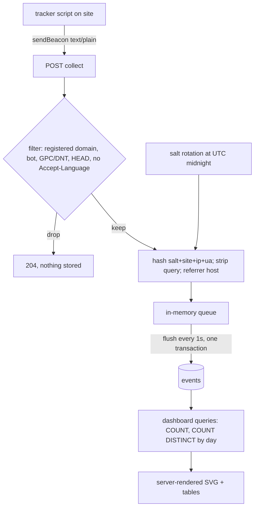
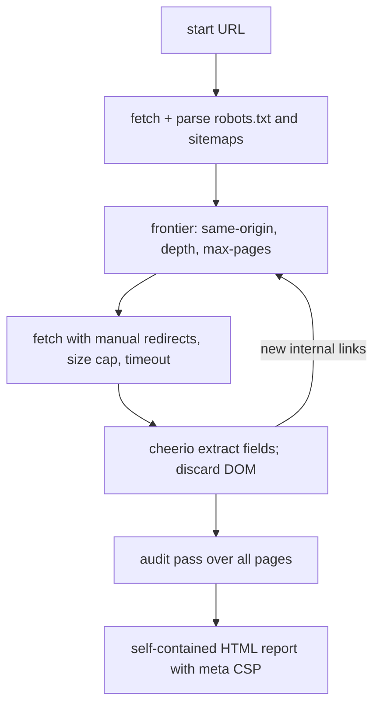
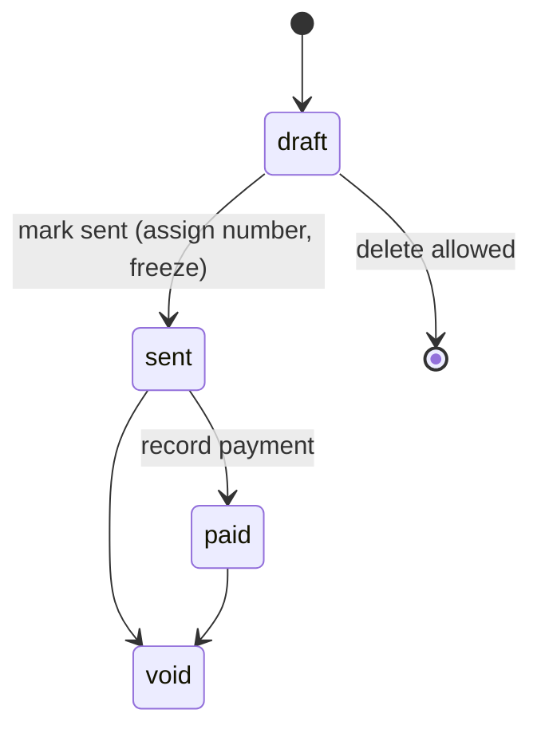
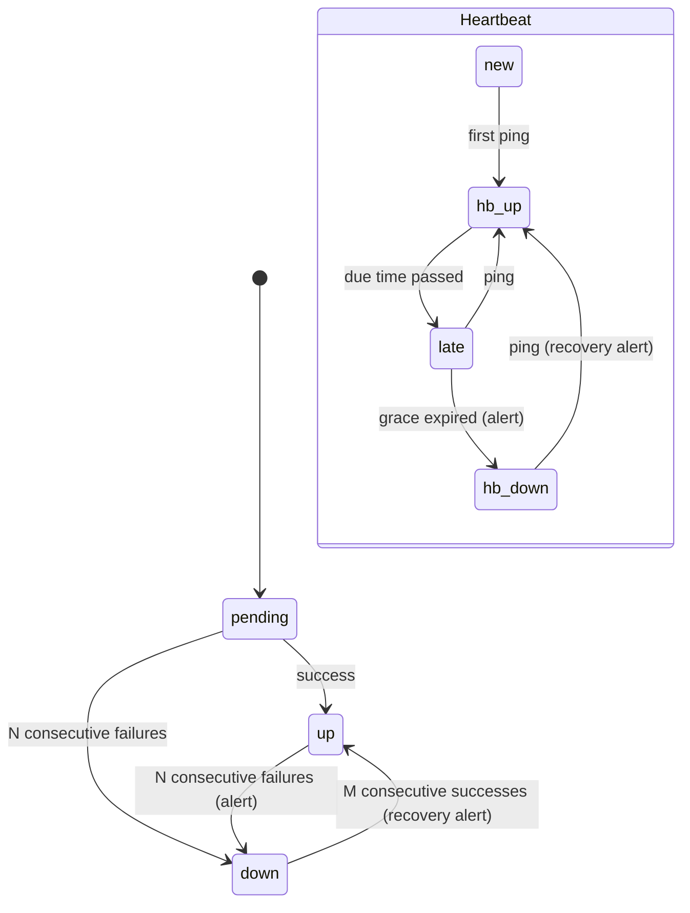

# Five New Self-Hosted Projects - Plan

## Goal Capsule

- **Objective:** Someone browsing the repo or the hub at `https://alifa20.github.io/vibe/` finds five more working replacements for paid apps: web analytics, a PDF toolkit, an SEO crawler, invoicing, and uptime/cron monitoring. Each one can be cloned and run locally from its README. The PDF toolkit and a sample crawl report also open directly on the hub.
- **Means:** Five standalone project folders that follow the repo's existing conventions, with hub tests changed so they no longer hardcode project counts (KTD1, KTD2, KTD3).
- **Authority:** Product Contract requirements win on behavior. KTDs win on mechanism. Unit text never overrides either.
- **Stop conditions:** Stop and ask if a project needs a shared package or pnpm workspace to work (R1), or if the PDF toolkit cannot pass `site/check-csp.mjs` without `'unsafe-inline'` or `'unsafe-eval'`.
- **Execution profile:** Work happens on a feature branch, never `main`. U1 goes first. After U1, the five project tracks (U2–U3, U4–U5, U6–U7, U8–U9, U10–U11) are independent and can land in any order or in parallel.
- **Who finishes:** The executor lands and verifies all units locally. The user decides on push, PR and merge. The hub deploys when `main` updates.

---

## Product Contract

### Summary

Add five standalone projects, chosen from the canivibecodeit.com "YES" list for how well they fit this repo:

- a cookieless analytics server
- a browser-only PDF toolkit, published as a live demo
- an SEO crawler CLI that writes a self-contained HTML report
- an invoicing app
- an uptime and cron-heartbeat monitor with email alerts

Each project ships with a README, tests, a pnpm lockfile and a hub entry. The hub's own tests stop hardcoding project counts so that adding a project doesn't break them.

### Problem Frame

The repo already replaces eight paid apps, and seven of them are canivibecodeit "YES" picks. The next most-voted YES apps that fit a small Node + SQLite or static-site shape are:

- analytics: Plausible, Umami, Fathom and Simple Analytics, about 42 votes combined
- PDF tools: iLovePDF, 41 votes
- SEO crawling: Screaming Frog, 55 votes
- invoicing: Invoice Ninja, 21 votes
- uptime monitoring: Better Stack and Cronitor

Granola and Wispr Flow have the most votes, but they need native macOS apps, so they are left out. Adding projects today is expensive in a way that has nothing to do with the projects themselves: about 20 assertions in `site/*.test.mjs` hardcode counts, slug orders and group sizes, and CI installs dependencies for one demo only.

### Key Decisions

- **One plan covering all five projects, each built as an independent track.** Chosen over five separate plans so the shared hub changes land once. Governs R1, R2. (session-settled: user-approved — chosen over five separate plans: one hub refactor instead of five rounds of test edits)
- **Every project stays standalone, with its own `package.json`, `pnpm-lock.yaml` and `packageManager` pin, and no shared package or workspace.** Governs R1. (session-settled: user-directed — chosen over a pnpm workspace during the npm-to-pnpm move: each folder must stay copyable and deployable on its own)
- **The analytics server copies the click-tracking pattern from bitly and linktree rather than importing it.** Governs R6, R7. (session-settled: user-approved — chosen over a shared tracking package, which would break R1)
- **The crawler is a CLI that writes a self-contained HTML report, not a server with a web UI.** Governs R17, R20. (session-settled: user-approved — chosen over a server UI: a report file is a better fit for running once and sharing, and it can be published on the hub)
- **Invoices become PDFs through browser print styles, with no PDF library on the server.** Governs R25. (session-settled: user-approved — chosen over server-side headless Chrome or a PDF library: no extra dependency and no native build)
- **Monitor alerts go by email only, using the same SMTP setup tally has.** Governs R30. (session-settled: user-approved — chosen over Slack, SMS or status pages, which are deferred)
- **The live hub does not report to the analytics server.** Governs R11. (session-settled: user-approved — the hub is static on Pages and no analytics server runs publicly)

### Requirements

**Shared conventions**

- R1. Each new project lives in its own top-level folder named after the paid app it replaces, the way `bitly/` and `linktree/` are. Each has its own `package.json` with `packageManager: pnpm@10.6.5`, a `pnpm-lock.yaml`, `pnpm.onlyBuiltDependencies` wherever native builds exist, and `engines.node >=22`.
- R2. Each new project has a hub entry in `site/projects.json`, a row in the root `README.md` table, and a README in the repo's usual shape: pitch, quick start, configuration, how it works, deploying, security notes, and what's out of scope.
- R3. Each new server project ships a commented `.env.example`. With nothing configured, it binds to `127.0.0.1`, and it trusts proxy headers only when `TRUST_PROXY` is set.
- R4. Each new project has a `test` script and automated tests for its core behavior.
- R5. Adding a project to `site/projects.json` does not require editing hardcoded counts, slug lists or group sizes in the hub tests, and CI installs dependencies for every demo that has a lockfile.

**Analytics server (`plausible/`)**

- R6. A site owner adds a small script tag to their site. Pageviews are then recorded, including pushState route changes in single-page apps, with no cookies and nothing stored on the visitor's device.
- R7. The server counts unique visitors per site per day from a hash of a daily rotating salt, the site, the IP and the user agent. The salt is deleted after its day ends, and the raw IP and user agent are never stored.
- R8. Requests from bots, requests without an `Accept-Language` header, HEAD requests, and requests sending `Sec-GPC: 1` (or DNT, when the site opts in) are not recorded.
- R9. A password-protected dashboard shows, for a chosen site and date range:
  - pageviews and daily unique visitors as a chart
  - top pages
  - referrer hosts
  - UTM sources and campaigns
  - browsers, operating systems and device types

  The dashboard states that visitor counts over a multi-day range are a sum of daily uniques.
- R10. Stored paths keep no query string apart from allowlisted UTM fields. Referrers are stored as host only, and self-referrals are dropped.
- R11. Events can be deleted after a configurable retention period. When the period is unset, events are kept.

**PDF toolkit (`ilovepdf/`)**

- R12. The toolkit runs entirely in the browser. No file ever leaves the device, and the page says so.
- R13. A user can merge PDFs, split a PDF by page ranges, and reorder, rotate and delete pages using page thumbnails.
- R14. A user can convert JPEG, PNG and WebP images to a PDF, and export the pages of a PDF as PNG or JPEG images.
- R15. A user can compress a PDF in two modes:
  - lossless, which keeps text selectable
  - rasterise, a stronger mode that warns it removes selectable text and links
- R16. The toolkit is published as a live demo on the hub and passes `site/check-csp.mjs`. A password-protected PDF prompts for its password before it can be edited.

**SEO crawler (`screamingfrog/`)**

- R17. A user runs one command against a start URL. The crawler stays on that origin, obeys robots.txt, and stops at configurable page, depth and body-size limits.
- R18. The crawl records, for each page:
  - status code
  - redirect chain
  - response time
  - HTML size
  - depth
  - title
  - meta description
  - H1s
  - canonical
  - robots directives from both meta tags and headers
  - images missing `alt`
  - outgoing links
- R19. The report flags:
  - broken internal and external links
  - redirect chains and redirect loops
  - missing, duplicate or overlong titles and meta descriptions
  - missing or multiple H1s
  - canonicals that point at a redirect, an error page or a noindex page
  - noindex pages
  - pages in the sitemap that the crawl never reached, or that are non-indexable
- R20. Output is one self-contained HTML file with no external requests. Every crawled value in it is escaped.
- R21. A sample report, made by crawling a fixture site bundled in the repo with no network access, is published on the hub as a live demo.

**Invoicing (`invoiceninja/`)**

- R22. A password-protected admin manages its own business details, clients, and invoices made of line items. Each line item has a description, quantity, unit price and tax rate.
- R23. Money is exact. Amounts are stored as integer minor units with one currency per invoice, and tax is computed once per tax rate per invoice, rounded half away from zero.
- R24. An invoice moves between draft, sent, paid and void. Overdue is computed as sent, past its due date and unpaid; it is never stored. An invoice number is assigned when the invoice is first marked sent, and numbers are sequential and gap-free within a year.
- R25. A print view of each invoice prints cleanly to PDF on A4 or Letter, depending on a setting. It repeats table headers across pages and shows a hint to turn off the browser's own headers and footers.
- R26. Once sent, an invoice's lines, totals, seller details and client details are frozen. Corrections happen by voiding the invoice, and a sent invoice cannot be deleted.
- R27. A dashboard lists invoices by status, with outstanding and overdue totals for each currency.

**Uptime and cron monitor (`betterstack/`)**

- R28. A password-protected admin manages HTTP monitors, each with a URL, an interval, a timeout and the expected status codes. The service checks each monitor on schedule, survives restarts without losing monitor state, and keeps each check's timeout shorter than its interval.
- R29. A monitor goes down only after a configurable number of consecutive failures and comes back up after a configurable number of successes. Alerts fire only on state changes.
- R30. Alerts are sent by email. A down alert names the monitor and the error. A recovery alert says how long the outage lasted.
- R31. Heartbeat checks expect pings to an unguessable URL, either every fixed period or on a cron schedule with a timezone, plus a grace period. They support start pings that measure duration and explicit fail pings.
- R32. HTTPS monitors warn once each when the certificate has 14, 7 and 1 days left before expiry.
- R33. When every HTTP monitor fails in the same cycle, the service checks a canary first. It suppresses down alerts if the canary also fails, because that points to the monitor's own network rather than the sites.

### Acceptance Examples

- AE1. Covers R7. Given a visitor who loads two pages today and one page tomorrow, the dashboard shows 1 visitor for each day and labels the 2-day total as 2, with a "sum of daily uniques" note.
- AE2. Covers R24, R26. Given draft invoice A and draft invoice B in 2026, marking B sent first assigns it `INV-2026-0001`, and marking A sent later assigns it `INV-2026-0002`. After that, editing A's lines is rejected.
- AE3. Covers R29, R30. Given a monitor with a down threshold of 2 that fails once, then succeeds, then fails twice, exactly one down email is sent, after the second consecutive failure.
- AE4. Covers R31. Given a heartbeat with cron `0 3 * * *` in `Australia/Melbourne` and a 30-minute grace period, no ping by 03:00 local time marks it late. If no ping arrives by 03:30, when the grace period ends, it is marked down and one email is sent.

### Success Criteria

- Each of the five projects can be cloned, installed with `pnpm install`, and run from its README alone. The three server projects (`plausible/`, `invoiceninja/`, `betterstack/`) are also configured from `.env.example`.
- The hub lists 14 projects. The PDF toolkit and the crawler sample report open as live demos with the nav strip, and `pnpm site:check` passes.

### Scope Boundaries

Outside this work:
- user accounts, teams, roles, billing, and hosting several customers on one instance, for all five projects
- deploying any of the five to a real server (READMEs document how, the plan doesn't do it)
- country lookup for analytics beyond reading `CF-IPCountry` behind a trusted proxy; a GeoIP database is not bundled
- emailing invoices to clients, online payments, recurring invoices, credit notes, FX conversion
- SMS, Slack or webhook alert channels, public status pages, and multi-location checks for the monitor
- JavaScript rendering in the crawler (it reads server HTML only)

#### Deferred to Follow-Up Work

- A public status page for the uptime monitor.
- Daily rollup tables for analytics, added once dashboard queries get slow.
- Data-centre IP-range bot filtering for analytics.

---

## Planning Contract

### Key Technical Decisions

- KTD1. **Hub tests derive counts and orders from the manifest.** `site/hub.test.mjs`, `site/nav.test.mjs` and `site/build.test.mjs` compute expected totals, live and server group sizes, slug order and prev/next wraparound from `site/projects.json`, and keep only behavioral assertions. The `build.test.mjs` fixture creates a stub demo output folder for every `demo` entry. Governs R5.
- KTD2. **CI installs every demo's dependencies, driven by the manifest.** A small root script reads `site/projects.json` and runs a frozen pnpm install in each `demo` project that has a `pnpm-lock.yaml`. The workflow caches against all demo lockfiles and still takes the pnpm version from `teleprompter/package.json`. Governs R5, R16, R21.
- KTD3. **Server projects are ESM with Express 5, better-sqlite3 ^13 and `node --test`.** This follows `qr/`: WAL, `foreign_keys`, `busy_timeout`, and an inline schema run at startup. Each app exports a factory that takes its database, clock and mailer, so tests run against in-memory SQLite and an ephemeral port using built-in `fetch`. tally's CommonJS style is not copied. `node --test` matches `site/*.test.mjs` and adds no test dependency. Governs R1, R4.
- KTD4. **One admin auth pattern for the three server apps.** An `ADMIN_PASSWORD` login form issues an HMAC-signed, expiring, httpOnly cookie (the bitly and zcal pattern). Password checks use sha256 plus `timingSafeEqual`. State-changing requests also pass a same-origin `Sec-Fetch-Site` guard, as in `qr/src/auth.js`. Login failures are rate-limited per IP, as in linktree. Governs R9, R22, R28.
- KTD5. **Strict CSP with no inline styles in every new UI.** CSS is served as files, so `style-src 'self'` holds. Charts are server-rendered SVG that uses presentation attributes (`width`, `height`, `fill`), never `style=""`. That rules out the inline-style bar charts of linktree and bitly. The one exception is the generated crawler report, which must be a single self-contained file (R20). It carries one hashed inline `<style>` under its own meta CSP (KTD12). Every rendered value that came from outside, such as collected paths, referrers, UTM values, crawled titles, client and invoice text, and monitor URLs, is HTML-escaped. Governs R9, R16, R20, R27.
- KTD6. **Analytics stores raw events and aggregates at query time.** There is one `events` table indexed on `(site_id, ts)` with a `day` column (bitly's shape). Inserts are batched through an in-memory queue that flushes every second in one transaction. Rollup tables are deferred. Bots are detected with `isbot` (Unlicense); `ua-parser-js` 2.x is AGPL and is not used. Browser, OS and device come from a small regex table. Governs R6, R8, R9.
- KTD7. **The visitor hash follows Plausible, not Umami.** The salt is `crypto.randomBytes(32)`, kept in memory and in one database row. It rotates at UTC midnight and the old salt is deleted at once. A visitor who crosses midnight counts once per day either way, so the old salt has no further use. Days are UTC days everywhere, in the `day` column and on the dashboard, so the hash and the day always change together. The hash is SHA-256 over salt, site, IP and UA, truncated to 64 bits. Umami derives its salt from the date, which can be recomputed. Governs R7.
- KTD8. **The tracker is a plain-text beacon.** The script sends `navigator.sendBeacon` with a `text/plain` body (falling back to `fetch` with `keepalive`), so requests never trigger a CORS preflight. The collect endpoint answers `Access-Control-Allow-Origin: *` without credentials and accepts only registered site domains. SPA views come from wrapping `pushState`/`replaceState` and listening for `popstate`. Governs R6, R8, R10.
- KTD9. **The PDF toolkit uses Vite + TypeScript with no UI framework.** Editing uses `@cantoo/pdf-lib` (MIT, maintained, can decrypt); upstream `pdf-lib` has had no release since 2021. Rendering uses `pdfjs-dist` v6, lazy-loaded, always with `isEvalSupported: false`. Lossless compression uses `@neslinesli93/qpdf-wasm` as a lazy chunk. mupdf is AGPL and is not used. The worker, wasm, cMaps and standard fonts are self-hosted under `public/`. Tests use vitest on the pure modules. Governs R13, R14, R15, R16.
- KTD10. **The PDF toolkit sets its CSP in a meta tag.** GitHub Pages cannot send headers, so the policy is `default-src 'self'; script-src 'self' 'wasm-unsafe-eval'; worker-src 'self' blob:; img-src 'self' blob: data:; connect-src 'self' blob:; style-src 'self'; object-src 'none'; base-uri 'none'`. A meta CSP cannot set `frame-ancestors`, which is accepted. The meta tag is injected by a small Vite plugin at build time only, not written into the `index.html` source. The dev server injects imported CSS as `<style>` elements, which this policy would block, so `pnpm dev` would render unstyled. Governs R12, R16.
- KTD11. **The crawler uses cheerio and its own robots.txt parser.** cheerio 1.2 parses each page, and only the extracted fields are kept. robots.txt follows RFC 9309: longest match wins, `Allow` wins ties, 5xx means disallow all, 4xx means allow all. It is about 100 lines rather than the unmaintained `robots-parser`. Redirects are followed by hand (`redirect: 'manual'`, at most 10 hops) so chains and loops get recorded. The default concurrency is 3, with `Retry-After` honored on 429 and 503. Governs R17, R18, R19.
- KTD12. **The crawler's sample report is a hub `demo`, not a new manifest kind.** `demo.build` starts a local static server over `screamingfrog/fixtures/site/`, crawls it, and writes `screamingfrog/sample/index.html`, which is gitignored in the project. The hub schema doesn't change. The report carries its own meta CSP with a hashed inline `<style>` and no script, so it passes `check-csp.mjs` and contains any crawled markup. Governs R20, R21.
- KTD13. **Invoices are enforced by the database.** Amounts are integer minor units, with the exponent taken from `Intl.NumberFormat(...).resolvedOptions().maximumFractionDigits`. Quantity is stored ×1000 and tax rates in basis points. Numbers are assigned inside `BEGIN IMMEDIATE` from a counter table keyed by year. The issue date, the numbering year and the overdue comparison all use a `timezone` setting, which defaults to the server's resolved timezone. A SQLite trigger rejects updates and deletes on an invoice's frozen columns and lines once its status is not `draft`. Only status moves (sent→paid, sent→void, paid→void) and payment fields may change. Governs R23, R24, R26.
- KTD14. **The monitor schedules each check with its own `setTimeout`.** Each monitor's `next_check_at`, state and counters are persisted in SQLite, so a restart resumes where it left off. Checks get a small jitter, a global cap on checks in flight, and `AbortSignal.timeout` set below the interval. Heartbeat due times come from `croner` (zero dependencies, timezone-aware). TLS expiry is read with `tls.connect` and `getPeerCertificate().valid_to`. Mail follows tally's `notify.js`: one cached nodemailer transport, and it never throws. Governs R28, R29, R30, R31, R32, R33.
- KTD15. **The test clock and transport are injected.** Scheduler, heartbeat and salt-rotation tests drive a fake clock and a fake mailer passed to the app factory (KTD3) instead of waiting on real time. Governs R4, R7, R29, R31.

### High-Level Technical Design

Analytics data flow:



Crawler pipeline:



Invoice lifecycle (overdue is a computed label, not a state):



HTTP monitor and heartbeat states:



### Output Structure

```text
plausible/       server.mjs, src/{app,db,collect,salt,ua,dashboard,auth,charts}.mjs, public/{script.js,app.css}, test/, .env.example, README.md
ilovepdf/        index.html, src/{main.ts,ops/*.ts,ui/*.ts}, public/{pdfjs/,qpdf/}, test/, vite.config.ts, README.md
screamingfrog/   bin/crawl.mjs, src/{crawl,robots,fetch,extract,audit,report,sitemap}.mjs, fixtures/site/, scripts/sample-report.mjs, test/, README.md
invoiceninja/    server.mjs, src/{app,db,money,numbering,auth,views,routes}.mjs, public/{app.css,print.css}, test/, .env.example, README.md
betterstack/     server.mjs, src/{app,db,scheduler,checks,heartbeat,tls,notify,auth,views}.mjs, public/app.css, test/, .env.example, README.md
site/            install-demos.mjs (new), projects.json, *.test.mjs (manifest-driven)
```

This tree shows the expected shape. The per-unit **Files** lists are authoritative.

### Assumptions

- Folder names follow the repo convention of naming each folder after the replaced app. Display names in `projects.json` are the project's own: analytics, pdf-tools, sitecrawl, invoices, uptime.
- The hub manifest order puts the new live demos after the existing ones, and the new server projects at the end of the server group.
- Package versions current on 2026-11-20 are assumed: `@cantoo/pdf-lib` 2.11, `pdfjs-dist` 6.5, `@neslinesli93/qpdf-wasm` 0.3, `cheerio` 1.2, `croner` 11, `isbot` 5.2, `nodemailer` 10.6, `better-sqlite3` 13. The executor pins exact versions at install.

### Risks

| Risk | Mitigation |
|---|---|
| pdfjs-dist v6 or qpdf-wasm needs CSP permissions beyond KTD10 | Check the built demo in a browser console. If the policy can't be met without `'unsafe-inline'` or `'unsafe-eval'`, stop (Goal Capsule stop condition). |
| CI time and cache grow as demos are added | KTD2 installs only demo projects. Server projects are never installed in Pages CI. |
| better-sqlite3 13 has no prebuilt binary for the local Node version, so it compiles from source | Already seen with `senja`. Builds succeed with Xcode tools. The README notes it. |
| Hand-rolled robots.txt matching mis-handles edge cases | Unit tests cover the RFC 9309 examples: longest match, Allow on ties, `$` and `*`, and 4xx/5xx handling. |
| Clock-dependent tests turn flaky | Injected clock (KTD15). No test sleeps on real time. |
| Projects named after real products read as clones | Same convention as the existing eight. Display names, UI and copy are original, and READMEs say "inspired by". |

---

## Implementation Units

| U-ID | Title | Key files | Depends on |
|---|---|---|---|
| U1 | Manifest-driven hub tests and demo installs | `site/*.test.mjs`, `site/install-demos.mjs`, `.github/workflows/pages.yml` | none |
| U2 | Analytics collector, salt and storage | `plausible/src/{collect,salt,ua,db}.mjs`, `plausible/public/script.js` | U1 |
| U3 | Analytics dashboard, retention and hub entry | `plausible/src/{dashboard,charts,auth}.mjs` | U2 |
| U4 | PDF toolkit core operations | `ilovepdf/src/ops/*.ts` | U1 |
| U5 | PDF toolkit UI, compression and hub demo | `ilovepdf/src/ui/*.ts`, `ilovepdf/index.html` | U4 |
| U6 | Crawler engine | `screamingfrog/src/{crawl,robots,fetch,extract,sitemap}.mjs` | U1 |
| U7 | Crawler audits, report and sample demo | `screamingfrog/src/{audit,report}.mjs`, `screamingfrog/scripts/sample-report.mjs` | U6 |
| U8 | Invoicing data model, money and numbering | `invoiceninja/src/{db,money,numbering}.mjs` | U1 |
| U9 | Invoicing admin, print view and hub entry | `invoiceninja/src/{routes,views,auth}.mjs`, `invoiceninja/public/print.css` | U8 |
| U10 | Uptime HTTP monitors, scheduler and alerts | `betterstack/src/{scheduler,checks,notify,db,auth,views}.mjs` | U1 |
| U11 | Heartbeats, TLS expiry, dashboard and hub entry | `betterstack/src/{heartbeat,tls,views}.mjs` | U10 |

### U1. Manifest-driven hub tests and demo installs

- **Goal:** Make adding a project a manifest-only change for the hub, and make CI install every demo's dependencies.
- **Requirements:** R5. KTD1, KTD2.
- **Dependencies:** none.
- **Files:**
  - modify `site/hub.test.mjs`, `site/nav.test.mjs`, `site/build.test.mjs`, `.github/workflows/pages.yml`, `package.json`
  - create `site/install-demos.mjs`
- **Approach:**
  1. Replace hardcoded counts (`9`, `8`, `2`, `6`, `"nine things"`), slug lists, group arrays and the prev/next wraparound titles with values computed from the loaded manifest.
  2. Keep the behavioral assertions, such as "live demos come before run-it-yourself" and "filter chips show counts that match their groups".
  3. Make the `build.test.mjs` `fixtureRoot()` create a stub output folder for every `demo` entry.
  4. Have `site/install-demos.mjs` run a frozen pnpm install in each demo folder that has a lockfile, then call it from the workflow and from a root `site:install` script.
  5. Point `cache-dependency-path` at all demo lockfiles.
- **Patterns to follow:** `site/hub.mjs` `loadManifest`; existing `site/build.test.mjs` fixture.
- **Test scenarios:**
  - Adding a fake tenth `page` project to a manifest copy leaves every existing hub test passing, with counts and chips updated.
  - Adding a fake third `demo` with a stub output folder makes `assemble({ skipBuild: true })` inject the nav and a CSP hash into it.
  - The first project's prev link wraps to the last project in manifest order.
  - The `install-demos` dry run lists teleprompter and skips carrd, which has no lockfile.
- **Verification:** `pnpm site:test` passes against the real manifest, unchanged in count. The workflow file installs through the new script.

### U2. Analytics collector, salt and storage

- **Goal:** Record privacy-safe pageviews from the tracker script.
- **Requirements:** R1, R3, R4, R6, R7, R8, R10, R11. KTD3, KTD6, KTD7, KTD8, KTD15.
- **Dependencies:** U1.
- **Files:**
  - create `plausible/package.json`, `plausible/server.mjs`, `plausible/src/app.mjs`, `plausible/src/db.mjs`, `plausible/src/collect.mjs`, `plausible/src/salt.mjs`, `plausible/src/ua.mjs`, `plausible/public/script.js`, `plausible/.env.example`, `plausible/.gitignore`
  - tests in `plausible/test/collect.test.mjs`, `plausible/test/salt.test.mjs`, `plausible/test/ua.test.mjs`
- **Approach:**
  1. Schema: `sites` (domain), `events` (site_id, ts, day, visitor_hash, path, referrer_host, utm_source, utm_medium, utm_campaign, browser, os, device, country), and `salts`.
  2. The collect handler validates the domain against `sites`, applies the R8 filters, normalises the path and referrer per R10, hashes the visitor per KTD7, and enqueues the row.
  3. The queue flushes on an interval and on shutdown.
  4. Retention pruning runs daily when `RETENTION_DAYS` is set.
  5. `script.js` stays small and readable, needs no build step, reads `data-domain`, and honors `data-respect-dnt`.
- **Patterns to follow:**
  - `linktree/src/stats.mjs` `visitorKey`, `classifyUA`, `referrerLabel`, and `clientIp` with `TRUST_PROXY`
  - `bitly/schema.sql` `day` column and indexes
  - `qr/src/db.js` pragmas
- **Test scenarios:**
  - Covers AE1. Two hits from the same IP and UA on one day give one distinct hash. The same visitor after the salt rotates gives a different hash.
  - After rotation, the previous salt is gone from memory and from the database.
  - An event at 23:59:59 UTC and one at 00:00:00 UTC from the same visitor land on different `day` values with different hashes.
  - Unregistered domain: request answered 202 or 204, nothing stored.
  - Bot UA, a missing `Accept-Language`, a HEAD request and `Sec-GPC: 1` each store nothing.
  - DNT is ignored unless the site opts in.
  - `/pricing?email=a@b.com&utm_source=x` is stored as path `/pricing` with utm_source `x`.
  - Referrer `https://www.google.com/search?q=..` is stored as `google.com`, and a same-host referrer is stored as null.
  - `X-Forwarded-For` is ignored unless `TRUST_PROXY` is set.
  - Integration: 50 events posted within one flush interval land in one transaction, and all are queryable after the flush.
  - With `RETENTION_DAYS=30`, events older than 30 days are pruned and newer ones kept.
- **Verification:** The app records hits from the script on a local test page, and no raw IP or UA appears anywhere in the database file.

### U3. Analytics dashboard, retention and hub entry

- **Goal:** Let the owner read the numbers, and list the project.
- **Requirements:** R2, R9, R11. KTD4, KTD5.
- **Dependencies:** U2.
- **Files:**
  - create `plausible/src/auth.mjs`, `plausible/src/dashboard.mjs`, `plausible/src/charts.mjs`, `plausible/src/views.mjs`, `plausible/public/app.css`, `plausible/README.md`
  - modify `site/projects.json`, `README.md`, `package.json` (the root description's count)
  - tests in `plausible/test/dashboard.test.mjs`, `plausible/test/auth.test.mjs`
- **Approach:**
  - Login, and a site list with an add-site form that shows the snippet to paste.
  - The form normalises the domain: it strips the scheme, `www.`, path and port, lowercases the host, and rejects anything left that is not a hostname, with a field error. Pasting `https://www.Example.com/` must register `example.com`, or the collector would drop every hit.
  - A site with no events shows "Waiting for the first pageview" with the snippet again. The snippet stays reachable from the site view afterwards.
  - Per-site view with range presets (today, 7d, 30d, custom).
  - Breakdown queries come from `events` with `GROUP BY`, and days with no data are filled with zeros, as `bitly/src/admin.js` `daySeries` does.
  - The SVG chart is drawn with attributes only (KTD5).
  - Every response sends CSP, `nosniff` and `Referrer-Policy` headers.
- **Patterns to follow:** `bitly/src/admin.js` session cookie and rollups; `qr/src/auth.js` same-origin guard; README shape of `tally/README.md`.
- **Test scenarios:**
  - Covers AE1. Seeded events across two days render a 2-day visitor total labelled as the sum of daily uniques.
  - Days with no events render as zero bars, not gaps.
  - Top pages are ordered by pageviews, with ties broken by path.
  - Unauthenticated dashboard requests redirect to login.
  - Tampered or expired cookies are rejected.
  - A wrong password is rejected, and after the lockout threshold even the correct password is refused until the window passes.
  - A cross-site POST to add a site is rejected by the same-origin guard.
  - The rendered dashboard HTML contains no `style=` attribute.
  - An event with path `/<script>alert(1)</script>` and utm_source `"><a href=x>` renders as escaped text in the top-pages and UTM tables (KTD5).
  - Adding `https://www.Example.com/` registers `example.com`, and adding `not a domain` shows a field error.
- **Verification:** A local run shows charts for seeded data. The hub lists the project as a run-it-yourself card, and `pnpm site:test` passes.

### U4. PDF toolkit core operations

- **Goal:** Pure, tested PDF operations, separate from the UI.
- **Requirements:** R1, R4, R13, R14, R15. KTD9.
- **Dependencies:** U1.
- **Files:**
  - create `ilovepdf/package.json`, `ilovepdf/vite.config.ts`, `ilovepdf/tsconfig.json`, `ilovepdf/src/ops/merge.ts`, `ilovepdf/src/ops/split.ts`, `ilovepdf/src/ops/pages.ts`, `ilovepdf/src/ops/images.ts`, `ilovepdf/src/ops/compress.ts`, `ilovepdf/src/ops/ranges.ts`
  - tests in `ilovepdf/test/ops.test.ts`, `ilovepdf/test/ranges.test.ts`
- **Approach:**
  - Operations take and return byte arrays and options. They never touch the DOM.
  - Rendering and rasterising sit behind an interface, so the pdf.js and canvas parts are injected by the UI and stubbed in tests.
  - The page-range parser accepts `1-3,5,8-` and rejects out-of-range or reversed ranges with a clear message.
  - WebP images are converted to JPEG through an injected canvas encoder before embedding.
  - Encrypted input is decrypted with the user's password, and the output is saved without encryption.
- **Patterns to follow:** teleprompter's Vite + TypeScript setup and oxlint config.
- **Test scenarios:**
  - Merging a 2-page and a 3-page PDF gives 5 pages in order.
  - Splitting `1-2,5` from a 5-page PDF gives two documents of 2 and 1 pages.
  - Rotating page 2 by 90 degrees sets its rotation and leaves other pages unchanged.
  - Deleting every page is rejected.
  - Ranges `0`, `6` on a 5-page PDF, `3-1` and `abc` each produce a validation error naming the problem.
  - JPEG and PNG embed one page per image, sized to the image.
  - An encrypted PDF without a password raises a "password required" error. With the right password the operation succeeds and the output is unencrypted.
  - Lossless compress through the qpdf stub reports before and after sizes and never returns a larger file than its input.
- **Verification:** `pnpm test` and `pnpm lint` pass in `ilovepdf/`.

### U5. PDF toolkit UI, compression and hub demo

- **Goal:** A usable single-page app on the hub.
- **Requirements:** R2, R12, R13, R14, R15, R16. KTD5, KTD9, KTD10.
- **Dependencies:** U4.
- **Files:**
  - create `ilovepdf/index.html`, `ilovepdf/src/main.ts`, `ilovepdf/src/ui/tools.ts`, `ilovepdf/src/ui/thumbnails.ts`, `ilovepdf/src/ui/download.ts`, `ilovepdf/src/render.ts`, `ilovepdf/public/` (pdf.js worker, cmaps, standard fonts, qpdf wasm), `ilovepdf/README.md`
  - modify `site/projects.json`, `README.md`, `package.json`
  - tests in `ilovepdf/test/render.test.ts`
- **Approach:**
  - Tool tabs for merge, split, organise, images to PDF, PDF to images, and compress.
  - Each file and tool has explicit states:
    - an empty drop-zone prompt
    - a per-file loading state
    - a password dialog for each encrypted file (R16), where a wrong password re-prompts inline and cancel removes the file
    - rejection of unreadable or non-PDF files, naming the file and the reason
    - a disabled run button with a progress indicator while a tool runs
    - a result with before/after sizes and a download button
    - an `aria-live` region for errors
  - Drag-and-drop input and page thumbnails rendered lazily with pdf.js.
  - Downloads use blob URLs that are revoked after use.
  - The rasterise mode shows its warning before it runs.
  - Files are added with the file picker or drop zone. An "all processing happens on this device" line is always visible.
  - The hub entry is a `demo` with `pnpm build --base=./`, output `dist`.
  - The KTD10 CSP meta is added only in the build (KTD10).
- **Patterns to follow:** `teleprompter` demo entry and relative base handling. `.vibe-nav ~ #root` height rule if the app is full height.
- **Test scenarios:**
  - The render adapter always passes `isEvalSupported: false` and the self-hosted worker, cMap and font URLs.
  - Dropping an encrypted PDF opens the password dialog. A wrong password re-prompts with an error, the right one loads the pages, and cancel removes the file.
  - The built `dist/index.html` contains the KTD10 CSP meta, and the source `index.html` does not.
  - The download helper revokes each blob URL after it is clicked.
  - Integration, manual browser check: a built demo served under a `/vibe/ilovepdf/` sub-path loads, merges two files, and logs no CSP violations.
  - `pnpm site:build` followed by `pnpm site:check` passes with the new demo included.
- **Verification:** The demo works from `pnpm site:serve` with the nav strip. The console shows no CSP errors during merge, thumbnails and compress.

### U6. Crawler engine

- **Goal:** A polite, bounded, same-origin crawl that produces page records.
- **Requirements:** R1, R4, R17, R18. KTD3, KTD11.
- **Dependencies:** U1.
- **Files:**
  - create `screamingfrog/package.json`, `screamingfrog/bin/crawl.mjs`, `screamingfrog/src/crawl.mjs`, `screamingfrog/src/robots.mjs`, `screamingfrog/src/fetch.mjs`, `screamingfrog/src/extract.mjs`, `screamingfrog/src/sitemap.mjs`, `screamingfrog/src/url.mjs`, `screamingfrog/fixtures/site/`
  - tests in `screamingfrog/test/robots.test.mjs`, `screamingfrog/test/url.test.mjs`, `screamingfrog/test/crawl.test.mjs`
- **Approach:**
  1. CLI flags: `--max-pages` (default 10000), `--max-depth`, `--concurrency` (default 3), `--delay`, `--out`, `--user-agent`, `--max-body-size` (default 5 MB).
  2. URL normalisation resolves against `<base href>`, lowercases the scheme and host, drops the fragment and default port, and keeps query strings.
  3. `mailto:`, `tel:`, `javascript:` and `data:` links are skipped.
  4. Bodies larger than `--max-body-size` are aborted.
  5. Sitemaps support index files and `.gz`.
  6. External links are checked with HEAD, then GET on 405, at low concurrency.
- **Execution note:** Write the robots.txt tests against the RFC 9309 examples first.
- **Patterns to follow:** `linktree/scripts/build.mjs` for the zero-framework Node script style.
- **Test scenarios:**
  - `Disallow: /private` with `Allow: /private/ok` allows `/private/ok/x` and blocks `/private/y`.
  - A tie between `Allow` and `Disallow` resolves to Allow.
  - `$` and `*` patterns match per the RFC.
  - A robots.txt 404 allows everything, and a robots.txt 503 blocks everything.
  - `HTTP://Example.com:80/a#x` normalises to `http://example.com/a`, while `/a?b=1` and `/a?b=2` stay distinct.
  - Integration against the fixture server: the crawl stays on the origin, respects `--max-depth 1` and `--max-pages 3`, records a 301→301→200 chain as 2 hops, and records a redirect loop as a loop rather than hanging.
  - A 429 with `Retry-After: 1` is retried once after the wait.
  - Extracted fields from a fixture page include title, meta description, both H1s, canonical, `noindex` from `X-Robots-Tag`, and two images without alt.
- **Verification:** `node bin/crawl.mjs` against the local fixture server finishes and prints a page count.

### U7. Crawler audits, report and sample demo

- **Goal:** Turn page records into a shareable report, and publish a sample.
- **Requirements:** R2, R19, R20, R21. KTD5, KTD12.
- **Dependencies:** U6.
- **Files:**
  - create `screamingfrog/src/audit.mjs`, `screamingfrog/src/report.mjs`, `screamingfrog/scripts/sample-report.mjs`, `screamingfrog/README.md`, `screamingfrog/.gitignore`
  - modify `site/projects.json`, `README.md`, `package.json`
  - tests in `screamingfrog/test/audit.test.mjs`, `screamingfrog/test/report.test.mjs`
- **Approach:**
  - Audits are pure functions over the page list, each returning issues tagged with severity.
  - The report has a summary, an issues list grouped by type with counts, and a page table sorted by status.
  - The report has no script, so the table is not interactive. Section links use anchors.
  - The fixture site deliberately contains one case of every issue type.
  - The hub entry is a `demo` with build `node scripts/sample-report.mjs` and output `sample`.
- **Patterns to follow:** `carrd/build.mjs` hashed CSP meta and self-contained HTML. `site/check-csp.mjs` rules.
- **Test scenarios:**
  - Two pages with the same title produce one duplicate-title issue listing both URLs.
  - A 71-character title is flagged as too long, and a 60-character title is not.
  - A canonical pointing at a URL that redirects is flagged, and one pointing at a 404 page is flagged too.
  - A URL in the sitemap but never linked is reported as orphaned.
  - A page titled `<script>alert(1)</script>` renders as escaped text in the report.
  - The report contains no external URLs in `src` or `href` attributes other than links to the crawled pages, and contains no `style=` attributes.
  - The report's inline style hash matches its meta CSP, checked with the same logic as `site/check-csp.mjs`.
  - Integration: the sample script runs with networking only to `127.0.0.1` and produces a report containing every fixture issue type.
- **Verification:** `pnpm site:build` and `pnpm site:check` pass, and the sample report opens on the hub with the nav strip.

### U8. Invoicing data model, money and numbering

- **Goal:** Correct money, numbering and immutability, enforced below the UI.
- **Requirements:** R1, R3, R4, R23, R24, R26. KTD3, KTD13.
- **Dependencies:** U1.
- **Files:**
  - create `invoiceninja/package.json`, `invoiceninja/server.mjs`, `invoiceninja/src/app.mjs`, `invoiceninja/src/db.mjs`, `invoiceninja/src/money.mjs`, `invoiceninja/src/numbering.mjs`, `invoiceninja/src/invoices.mjs`, `invoiceninja/.env.example`, `invoiceninja/.gitignore`
  - tests in `invoiceninja/test/money.test.mjs`, `invoiceninja/test/numbering.test.mjs`, `invoiceninja/test/invoices.test.mjs`
- **Approach:**
  - Tables: `settings` (seller details, page size, default currency, payment terms, timezone), `clients`, `invoices`, `invoice_lines`, and `counters`.
  - Seller and client snapshot columns live on `invoices`.
  - Triggers enforce KTD13.
  - Totals are computed in one module and saved on send, so a stored sent invoice never recomputes its totals.
- **Execution note:** Implement money and numbering test-first; they are the parts that must not drift.
- **Patterns to follow:** `qr/src/db.js`. zcal's `schema_migrations` table for versioned schema changes.
- **Test scenarios:**
  - Lines of 3 × 33.33 at 10% and 1 × 0.01 at 10% total 100.00 net and 10.00 tax, computed per rate per invoice and rounded half away from zero.
  - A JPY invoice of 3 × 333 stores 999 with exponent 0. A KWD amount keeps 3 decimals.
  - Quantity 1.5 hours × 120.00 gives 180.00.
  - Covers AE2. Numbers are assigned in send order, are gap-free, and the counter resets in a new year (a 2027 send gives `INV-2027-0001`).
  - Covers AE2. Updating a line on a sent invoice raises a database error. Changing its client's address leaves the invoice snapshot unchanged.
  - Deleting a draft succeeds, and deleting a sent invoice is rejected.
  - Sent→paid and sent→void succeed. Paid→draft is rejected.
  - An invoice is overdue when sent, past its due date and unpaid. It is not overdue on the due date itself or once paid.
  - Two concurrent sends from two connections never receive the same number.
  - With timezone `Australia/Melbourne`, a send at 2027-01-01 08:00 local time (still 2026 in UTC) gets `INV-2027-0001`.
- **Verification:** All tests pass using in-memory SQLite and a file-backed database for the concurrency case.

### U9. Invoicing admin, print view and hub entry

- **Goal:** Day-to-day use: clients, invoices, printing, and a dashboard.
- **Requirements:** R2, R22, R25, R27. KTD4, KTD5.
- **Dependencies:** U8.
- **Files:**
  - create `invoiceninja/src/auth.mjs`, `invoiceninja/src/routes.mjs`, `invoiceninja/src/views.mjs`, `invoiceninja/public/app.css`, `invoiceninja/public/print.css`, `invoiceninja/README.md`
  - modify `site/projects.json`, `README.md`, `package.json`
  - tests in `invoiceninja/test/routes.test.mjs`, `invoiceninja/test/print.test.mjs`
- **Approach:**
  - Server-rendered forms: settings, clients CRUD, an invoice editor with an add-line form, and server-validated line rows.
  - Mark sent, record payment and void each go through a server-rendered confirmation page that states the consequence. Sending assigns the number and freezes the invoice, and void is permanent. Inline `confirm()` handlers would break the CSP.
  - Record payment means full payment only, with a paid date and an optional method, matching the single paid state.
  - A non-draft invoice renders read-only with its status as a text label and no edit or delete controls.
  - `print.css` uses `@page` with the configured size, repeats `thead`, keeps rows from splitting, and hides the print hint and admin chrome.
  - The dashboard groups totals by currency.
- **Patterns to follow:** tally's `src/{validate,views,routes}` split, ported to ESM. tally's form error re-render pattern.
- **Test scenarios:**
  - Creating a client, then a draft with two lines, renders correct totals in the editor.
  - Invalid input (negative quantity, unknown currency, a tax rate above 100%) re-renders the form with field errors and saves nothing.
  - The print view of a sent invoice contains the number, seller snapshot, client snapshot, lines, per-rate tax rows and the total, and uses the A4 or Letter `@page` rule from settings.
  - The print view of a draft shows a "DRAFT" marker and no number.
  - The dashboard shows outstanding totals per currency, and an overdue invoice appears in the overdue total only.
  - Unauthenticated routes redirect to login, and cross-site POSTs are rejected.
  - Pages contain no `style=` attribute.
- **Verification:** A local run can create, send, print to PDF from the browser, and mark paid. The hub card is listed and `pnpm site:test` passes.

### U10. Uptime HTTP monitors, scheduler and alerts

- **Goal:** Reliable HTTP checks with flap-resistant alerts.
- **Requirements:** R1, R3, R4, R28, R29, R30, R33. KTD3, KTD14, KTD15.
- **Dependencies:** U1.
- **Files:**
  - create `betterstack/package.json`, `betterstack/server.mjs`, `betterstack/src/app.mjs`, `betterstack/src/db.mjs`, `betterstack/src/scheduler.mjs`, `betterstack/src/checks.mjs`, `betterstack/src/notify.mjs`, `betterstack/src/auth.mjs`, `betterstack/src/views.mjs`, `betterstack/public/app.css`, `betterstack/.env.example`, `betterstack/.gitignore`
  - tests in `betterstack/test/scheduler.test.mjs`, `betterstack/test/checks.test.mjs`, `betterstack/test/notify.test.mjs`
- **Approach:**
  - Tables: `monitors` (url, interval, timeout, expected statuses, thresholds, state, counters, next_check_at), `checks` (recent results, pruned to N per monitor), and `incidents` (start, end, cause).
  - Login (KTD4) and monitor create, edit, pause and delete forms with field errors, including the timeout-below-interval rule. U11 adds the dashboard and heartbeat screens on top.
  - A check records its status, latency and error.
  - A state change opens or closes an incident and sends one email.
  - A cycle where every monitor fails checks the canary (`CANARY_URL`, default a well-known HTTPS endpoint) before alerting, per R33.
- **Patterns to follow:** `tally/src/notify.js` and the `smtp` block of `tally/src/config.js`, ported to ESM.
- **Test scenarios:**
  - Covers AE3. Fail, success, fail, fail with a down threshold of 2 sends exactly one down email, after the fourth check.
  - Covers R30. Two successes with an up threshold of 2 send one recovery email naming the outage duration from the injected clock.
  - A timeout produces a failure whose error says "timeout".
  - A 500 when 200–299 is expected produces a failure.
  - Configuring a timeout of at least the interval is rejected at create time.
  - When every monitor fails and the canary fails, no down emails are sent and a warning is logged. When the canary succeeds, the alerts go out.
  - After a restart, monitors resume at their persisted `next_check_at` and are not all checked at once.
  - With SMTP unset, alerts are logged and skipped and the scheduler keeps running. A thrown transport error does not stop it either.
- **Verification:** Tests pass with the fake clock and mailer. A local run against a stopped port alerts once and recovers once.

### U11. Heartbeats, TLS expiry, dashboard and hub entry

- **Goal:** Cron monitoring, certificate warnings, and a status dashboard.
- **Requirements:** R2, R28, R31, R32. KTD4, KTD5, KTD14.
- **Dependencies:** U10.
- **Files:**
  - create `betterstack/src/heartbeat.mjs`, `betterstack/src/tls.mjs`, `betterstack/README.md`
  - modify `betterstack/src/views.mjs`, `betterstack/public/app.css`
  - modify `site/projects.json`, `README.md`, `package.json`
  - tests in `betterstack/test/heartbeat.test.mjs`, `betterstack/test/tls.test.mjs`, `betterstack/test/views.test.mjs`
- **Approach:**
  - Heartbeats are stored with a random UUID token, a mode (period or cron with timezone), grace, last ping, last start and state.
  - Ping endpoints `/ping/:token`, `/ping/:token/start` and `/ping/:token/fail` accept GET and POST, and answer 200 or 404 without revealing anything else.
  - After a process restart, heartbeats get one grace period before they can go down.
  - The heartbeat form validates the cron expression and IANA timezone with field errors. Each heartbeat's detail view shows its full ping, start and fail URLs with a `curl` example. Deleting asks for confirmation.
  - The dashboard lists monitors and heartbeats with state, last check, 24-hour uptime percentage, a latency sparkline drawn as SVG attributes, and recent incidents.
  - The README includes example monitors for the other vibe apps and a crontab line for heartbeat pings.
- **Patterns to follow:** same as U10. croner `nextRun` for due times.
- **Test scenarios:**
  - Covers AE4. A heartbeat with cron `0 3 * * *`, timezone `Australia/Melbourne` and 30 minutes grace is up before 03:00, late from 03:00, and down with one alert after 03:30 local time. The same check holds across a DST change date.
  - A period heartbeat of 1 hour plus 5 minutes grace with no ping for 66 minutes goes down. A ping then recovers it with a recovery email.
  - `/start` followed by a ping 42 seconds later records a 42-second duration. `/fail` immediately marks it down and alerts.
  - An unknown token returns 404, and tokens are not sequential.
  - A certificate expiring in 13 days triggers one 14-day warning, and the next check sends no second warning. At 6 days the 7-day warning fires once.
  - A TLS connection error is shown as an error state, not as an expiry warning.
  - Dashboard pages require login and contain no `style=` attribute.
- **Verification:** A local run shows a heartbeat going late and down without pings, then recovering after a `curl`. The hub card is listed and `pnpm site:test` passes.

---

## Verification Contract

| Gate | Command | Where | Proves |
|---|---|---|---|
| Hub tests | `pnpm site:test` | repo root | R5. Every hub entry renders and navigates. |
| Hub build and CSP | `pnpm site:build` then `pnpm site:check` | repo root | R16, R21. Both new demos build under a sub-path and pass the CSP gate. |
| Project tests | `pnpm test` | each of `plausible/`, `ilovepdf/`, `screamingfrog/`, `invoiceninja/`, `betterstack/` | R4 and each project's requirements |
| PDF lint and build | `pnpm lint`, `pnpm build --base=./` | `ilovepdf/` | R16 |
| Clean install | `pnpm install --frozen-lockfile` | each new project | R1 |
| Browser check | open `pnpm site:serve`, use the PDF tools and the sample report with the devtools console open | repo root | R12, R16. No CSP violations. |
| CI | the `pages` workflow passes on the PR | GitHub Actions | KTD2 |

---

## Definition of Done

- Every requirement R1–R33 is met and every acceptance example AE1–AE4 has a passing test.
- All gates in the Verification Contract pass. No test sleeps on real time.
- The root `README.md` table, the root `package.json` description and `site/projects.json` all list 14 projects, consistently.
- Each new project's README lets someone run it from a fresh clone.
- No new project imports code from another project folder.
- Abandoned approaches and experimental code are removed from the diff. No stray `console.log` debugging is left in.
- Per unit: each unit's own Verification line holds before the next unit in the same track starts.
